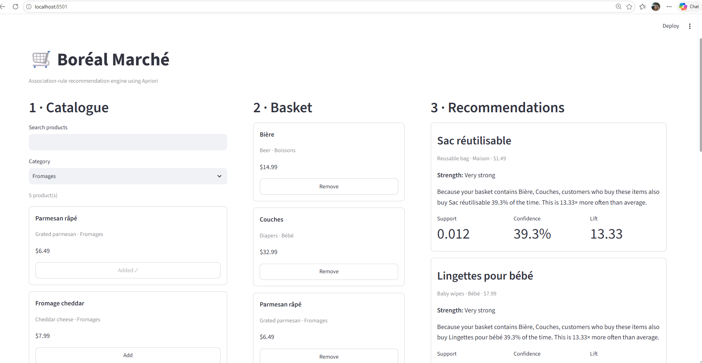

# Boréal Marché — Association-Rule Recommendation Engine

**Course:** 420-975-VA — Unsupervised Learning  
**Algorithm:** Apriori (`mlxtend.frequent_patterns.apriori`)  
**Application:** Streamlit  
**Dataset:** 1,000,000 shopping baskets, 8,379,837 transaction rows, 98 products

## 1. Project objective

Boréal Marché currently shows the same popular products to every customer. The goal of this project is to build an **unsupervised recommendation system** that discovers product co-occurrence patterns from transaction data and recommends products based on the current contents of a customer's basket.

This is an unsupervised learning problem because there is no labelled target variable. Apriori discovers frequent itemsets and association rules directly from shopping-basket behaviour.

The system answers:

> Given what this customer has already put in their basket, what should we suggest next — and why?

## 2. Repository structure

```text
boreal-reco/
├── README.md
├── requirements.txt
├── data/
│   ├── transactions.zip
│   └── products.csv
├── notebooks/
│   └── 01_mining.ipynb
├── models/
│   ├── rules.json
│   └── metadata.json
├── app/
│   └── streamlit_app.py
└── reports/
    ├── benchmark.md
    └── screenshots/
        ├── empty_basket_cold_start.png
        ├── multi_item_recommendations.png
        ├── no_rule_fires_safran.png
        └── rules_that_fired.png
```

## 3. Data preparation

The provided transaction file is in long format: one row per purchased item. It was converted into a boolean basket × product matrix for Apriori.

Verified dataset statistics:

- **8,379,837** transaction rows
- **1,000,000** unique baskets
- **98** products
- **8.38** items per basket on average
- Full-year data covering January through December 2026

A memory-conscious sparse boolean representation was used for the basket matrix.

### Frequency observation and prediction before mining

`Sac réutilisable` appears in approximately 90% of baskets. Before mining, I predicted that it would create many rules with very high confidence but lift close to 1, because the item is already extremely common.

The later rule evaluation confirmed this prediction: confidence alone can make a very common consequent look predictive, while lift reveals that the antecedent adds little information.

### Duplicate-candidate check

`Baguette` and `Pain baguette rustique` were inspected as possible duplicate catalogue entries because their names are similar. The data provides evidence that they should **not** be merged: `Baguette` appears in **69,400** baskets, `Pain baguette rustique` appears in **42,219** baskets, they occur together in **3,009** baskets, and their catalogue prices differ (**$2.99** vs **$3.99**). These observations support treating them as separate SKUs. Merging them could artificially increase support and distort the association structure.

## 4. Apriori benchmark

Apriori was executed with four required minimum-support values using `low_memory=True`.

| min_support | Itemsets | Rules | Time (s) | Peak additional RSS (MB) | Outcome |
|---:|---:|---:|---:|---:|---|
| 0.050 | 191 | 282 | 3.64 | 212.36 | Success |
| 0.020 | 658 | 2,707 | 7.52 | 262.26 | Success |
| 0.010 | 2,267 | 7,817 | 15.86 | 219.13 | Success |
| 0.005 | 7,106 | 23,918 | 44.94 | 231.38 | Success |

Lowering `min_support` greatly increases the number of frequent itemsets and rules. From 0.05 to 0.005, frequent itemsets increased from 191 to 7,106 and rules increased from 282 to 23,918. Runtime increased from **3.64 seconds** to **44.94 seconds**.

The final mining configuration used:

- `min_support = 0.005`
- `min_confidence = 0.30`
- keep only rules with `lift > 1`

This produced **22,476 positive-association rules**.

### Why `low_memory=True`

Apriori can create large intermediate candidate structures. On one million baskets, the default strategy can exhaust memory because candidate combinations grow rapidly as support is lowered. `low_memory=True` reduces the size of intermediate structures held in memory at one time, trading some speed for lower memory pressure.

The benchmark above reports the successful measured runs used for the final project; no failed run or memory measurement was fabricated.

## 5. Rule evaluation

### Support

Support describes how often the complete item combination appears across all baskets.

### Confidence

Confidence describes how often the consequent is purchased among baskets that contain the antecedent.

### Lift

Lift describes how much more often the antecedent and consequent occur together compared with the consequent's normal baseline frequency.

A lift:

- greater than 1 indicates a positive association;
- close to 1 indicates little or no association;
- below 1 indicates a negative association.

### Confidence versus lift

The confidence ranking was strongly affected by very common items such as `Sac réutilisable`. Many rules pointing to this item had confidence around 90%, but lift close to 1.

The lift ranking instead surfaced more specific relationships such as raclette, sushi, and baby-product combinations. This shows why confidence alone is not sufficient for ranking recommendations.

For the production rule set, only rules with `lift > 1` were kept.

## 6. Coverage

After filtering to positive associations, the recommender can produce **58 of the 98 catalogue products** as consequents.

- Recommendable products: **58**
- Catalogue products: **98**
- Coverage: **59.18%**
- Latest mining run: **2026-10-29 20:26:37**

This means 40 products are never recommended by the current rule set. Coverage is therefore an important limitation and also shows the risk of reinforcement bias if the system repeatedly recommends only products that already have strong historical associations.

## 7. Seasonal analysis

The data covers a complete year, so the rules were mined separately for:

- **Summer:** June–August
- **Winter:** December–February

Results:

- Summer baskets: **252,474**
- Winter baskets: **246,965**
- Summer rules: **53,842**
- Winter rules: **15,396**

A shared rule illustrates the seasonal effect:

**(Ketchup, Pain à hamburger, Steak de boeuf) → (Charbon de bois, Sauce BBQ)**

| Metric | Summer | Winter |
|---|---:|---:|
| Support | 0.0377 | 0.0052 |
| Confidence | 0.4854 | 0.5136 |
| Lift | 3.84 | 29.98 |

The rule is much more common in summer, but its winter lift is much larger because the consequent combination is much rarer in winter. This demonstrates that confidence alone can hide important seasonal effects.

### Rule present in summer but absent from the winter rule set

**(Farine tout usage, Oeufs, Sac réutilisable) → (Bananes, Sirop d'érable)**

Summer:

- Support: **0.0051**
- Confidence: **0.3096**
- Lift: **16.85**

When checked directly in winter:

- Support: **0.0047**
- Confidence: **0.2981**
- Lift: **16.67**

It falls below both the 0.005 support threshold and the 0.30 confidence threshold.

### Rule present in winter but absent from the summer rule set

**(Charbon de bois, Sauce BBQ) → (Ketchup, Pain à hamburger, Steak de boeuf)**

Winter:

- Support: **0.0052**
- Confidence: **0.3035**
- Lift: **29.98**

When checked directly in summer:

- Support: **0.0377**
- Confidence: **0.2984**
- Lift: **3.84**

It has sufficient summer support, but its confidence is slightly below the 0.30 threshold, so it does not appear in the summer rule set.

### Re-mining recommendation

Boréal Marché should re-mine its association rules **at least quarterly**, and preferably before major seasonal periods. Serving one static year-round rule file in January can over-represent patterns driven by summer purchasing behaviour and reduce recommendation relevance.

## 8. Offline mining and online recommendation

Mining is performed offline in the notebook. The Streamlit application **does not run Apriori**.

The notebook saves:

- `models/rules.json`
- `models/metadata.json`

The application loads these files at startup and performs fast subset matching against the customer's current basket.

Final metadata:

- Algorithm: Apriori
- Library: mlxtend
- Minimum support: 0.005
- Minimum confidence: 0.30
- Minimum lift: 1.0
- Number of saved rules: **22,476**
- Catalogue products: **98**
- Recommendable products: **58**
- Coverage: **59.18%**

## 9. Streamlit application

The application contains the three required zones:

1. **Catalogue**
   - all 98 products
   - search
   - category filter
   - Add button

2. **Basket**
   - chosen products
   - price and category
   - Remove button
   - Clear basket
   - basket total

3. **Recommendations**
   - up to five recommendations
   - sorted by descending lift
   - product name, category, and price
   - support, confidence, and lift
   - strength label
   - plain-language explanation

If multiple rules recommend the same product, only the rule with the highest lift is used for that recommendation.

An item already present in the basket is never recommended again.

The expandable **Rules that fired** section exposes the rules behind the recommendations and makes the system auditable.

## 10. Edge cases tested

### Empty basket / cold start

When the basket is empty, no rule can fire. The application displays an explicit message and falls back to popular products.


### No rule fires / rare product

`Safran` was used as a rare-product test. When no association rule matches the basket, the application displays an explicit message and falls back to popular products rather than showing an empty panel.


### Multi-item basket

A multi-item basket triggers association rules and produces recommendations with support, confidence, lift, strength, and explanations.



### Rules that fired

The application displays the underlying fired rules, including antecedent, consequent, support, confidence, and lift.


## 11. Famous association-rule example: beer and diapers

The dataset reproduces the well-known **beer and diapers** retail-analytics example.

For the direction:

**Couches → Bière**

the full-year data gives approximately:

- Support: **3.07%**
- Confidence: **36.56%**
- Lift: **2.43**

This is a positive association, but it does **not** prove that buying diapers causes customers to buy beer. Association rules describe correlation in observed baskets, not causation.

## 12. Limitations and possible improvements

### Limitation 1 — Incomplete catalogue coverage

Only 58 of 98 products can currently be recommended.

**Possible improvement:** use a hybrid recommender or add content-based similarity so products without strong association rules can still be surfaced.

### Limitation 2 — Cold start and rare products

Rare items may not meet the support threshold, so no rule can fire.

**Possible improvement:** combine association rules with popularity, product similarity, or a separate cold-start strategy.

### Limitation 3 — Seasonality

A single annual rule file can become stale when purchasing behaviour changes by season.

**Possible improvement:** re-mine rules quarterly or maintain seasonal rule sets.

### Limitation 4 — No personalization beyond the current basket

Association rules use basket contents but do not model individual customer history or preferences.

**Possible improvement:** add collaborative filtering or customer-segment models while preserving explainability.

## 13. Ethical and legal considerations

### Explainability

The recommendation system is designed to be auditable. Each recommendation includes a plain-language explanation plus support, confidence, and lift, and the application exposes the exact rules that fired.

### Correlation is not causation

Association rules identify co-occurrence patterns. They do not prove causal relationships. The beer-and-diapers example is a clear reminder of this limitation.

### Reinforcement bias

Repeatedly recommending only historically popular or highly connected products can reinforce existing purchasing patterns and reduce catalogue exposure. The 59.18% coverage measurement makes this limitation visible.

## 14. Reproducibility

Install the dependencies:

```bash
python -m pip install -r requirements.txt
```

Run the mining notebook and ensure every cell is executed and all outputs are visible:

```bash
jupyter notebook notebooks/01_mining.ipynb
```

Run the application:

```bash
python -m streamlit run app/streamlit_app.py
```

The Streamlit application loads pre-mined JSON rule files and does not run Apriori online.
